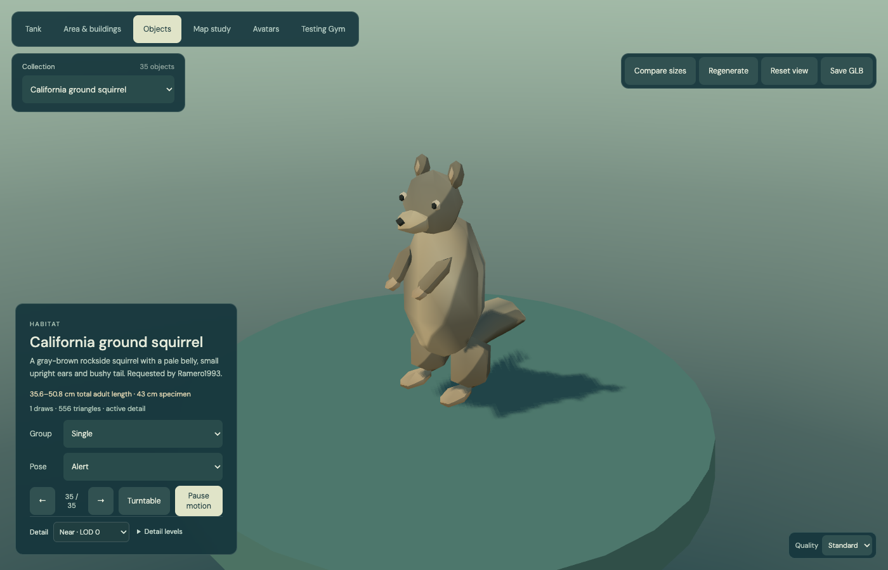
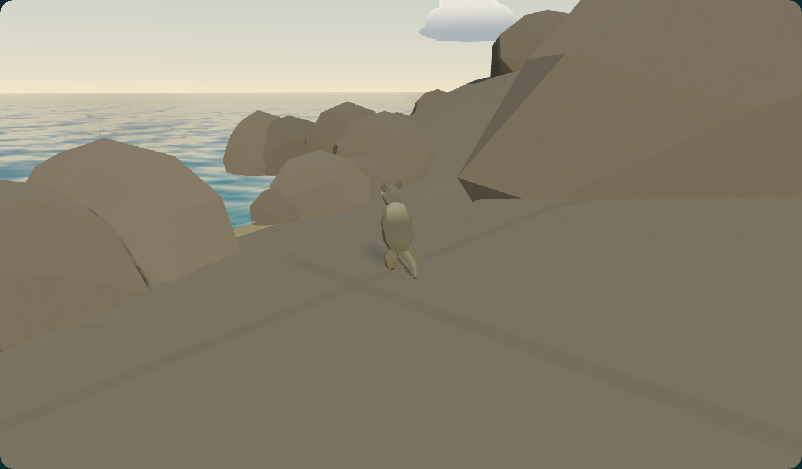

# California ground squirrels

Requested by **Ramero1993**, as relayed in the feature request. The Objects library includes a California ground squirrel (`Otospermophilus beecheyi`) with Alert, Foraging and Scurrying poses, plus groups of 8 or 32. The Testing Gym places **eight** around the granite at the rocky point of Lovers Point. Use **Gym → Menu → Rockside squirrels** to visit them.

The supplied upright photograph guides the pear-shaped torso, compact ears, pale belly, short muzzle, folded forepaws and gray-brown coat. It is a small, single frontal view; the back, tail profile and quadruped proportions are inferred. Broad vertex colors stand in for fur and speckling. There are no fur strands, photo textures or added outline passes. This is a stylized game asset rather than an exact reconstruction.

## Scale and behavior

[UC IPM's California ground squirrel description](https://ipm.ucanr.edu/home-and-landscape/ground-squirrel/) gives a total length of 14–20 inches, including the tail (35.6–50.8 cm). The factory's representative specimen is approximately **43 cm nose to tail** when crouched and **34 cm high** when upright. One scene unit is one metre, roots remain unscaled, and the camera frames the animal at its real scene size. Pose height, speed and cadence are authored estimates, not measured movement data.

The group alternates alert pauses, foraging and short scurries within 3 m of each authored home. Nearby players cause a bounded retreat. Placement and each movement step check paving, terrain elevation and existing solid collision proxies; the squirrels stay out of water, buildings and paths. Rockside homes are artistic placements, not wildlife sighting coordinates. The animals have no solid player-blocking colliders. The single-asset factory publishes a coarse capsule and feet/head anchors for a future physics owner; visual animation and LOD never move the root or alter these descriptors.

## Rendering contract

| Detail | Triangles per animal | Eight-animal group | Color-pass draws |
| --- | ---: | ---: | ---: |
| Near | 556 | 4,448 | 1 |
| Mid | 236 | 1,888 | 1 |
| Far | 140 | 1,120 | 1 |

All poses use one palette-colored toon mesh. Four **relative** morph targets describe two foraging and two gait samples. Relative targets are required for the node renderer's instanced base-weight behavior; the one-instance fallback also receives `morphTargetInfluences`. Every stable instance slot has independent phase, pose blend and root matrix. Pose updates only change the small shared morph-weight texture and instance matrices; source vertex buffers remain immutable. The same authored topology family supplies all distance levels.

The geometry family occupies approximately **154 KiB**, shared by all eight animals. Instance matrices, colors, the morph-weight texture and renderer-specific buffers are additional. Model figures above exclude scene, shadow and output submissions. The scene root is separate from static park geometry, like the other mobile wildlife, and sleeps beyond 65 m and in regional overview. Reduced motion freezes decorative simulation. Geometry LOD does not change animal identity, home, terrain checks or behavior. Disposal releases the morph texture and all variants, including through the generic object-library disposal path.

## Source ownership and verification

- [`definition.ts`](../src/models/habitat/ground-squirrel/definition.ts): size evidence, poses, budget and request credit.
- [`geometry.ts`](../src/models/habitat/ground-squirrel/geometry.ts): named body/face/limb/tail components, seeded palette and authored LOD/morph topology.
- [`createGroundSquirrel.ts`](../src/models/habitat/ground-squirrel/createGroundSquirrel.ts): individual and instanced factories, pose weights and lifecycle.
- [`squirrels.ts`](../src/viewer/testingGym/squirrels.ts): eight rockside homes, bounded movement, player response and interest management.
- [`ground-squirrel.test.ts`](../tests/ground-squirrel.test.ts): deterministic shape, per-level budgets, immutable geometry, stable morph slots, disposal, safe terrain/path placement and distance/reduced-motion sleep.
- [`ground-squirrel-browser.mjs`](../tests/ground-squirrel-browser.mjs): actual WebGPU/WebGL 2 rendering, every pose/LOD and 1/8/32 library groups, plus the real Gym shortcut and park batch.

Run `node --import tsx --test tests/ground-squirrel.test.ts` and, with the preview running, `node tests/ground-squirrel-browser.mjs`. Browser evidence is generated under `artifacts/ground-squirrel/` by default; `PREVIEW_URL`, `ARTIFACT_DIR` and `BROWSER_CHANNEL` are supported. Source photos remain outside the public release.

## Current review

The complete unit suite passed **594 tests**. After refining the pose bounds, all **70 affected model/LOD/inventory tests** passed again. Production build/typecheck, documentation checks, and WebGPU/WebGL 2 browser checks passed. The measured [cost summary](reviews/ground-squirrel-costs.json) distinguishes geometry costs from full-scene submissions.

