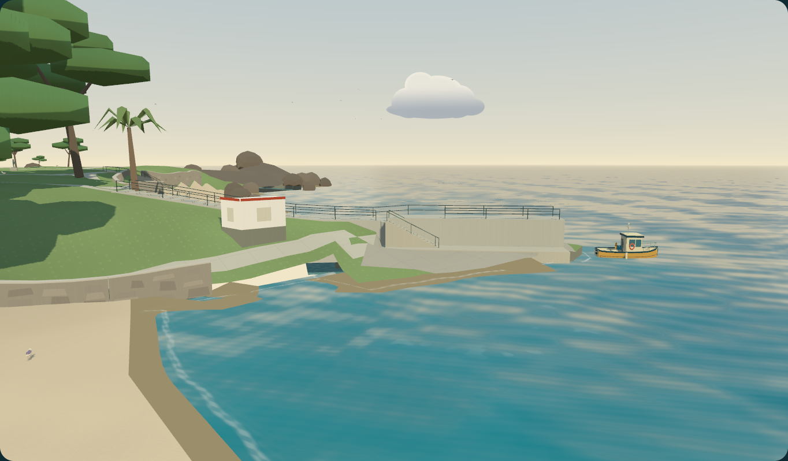
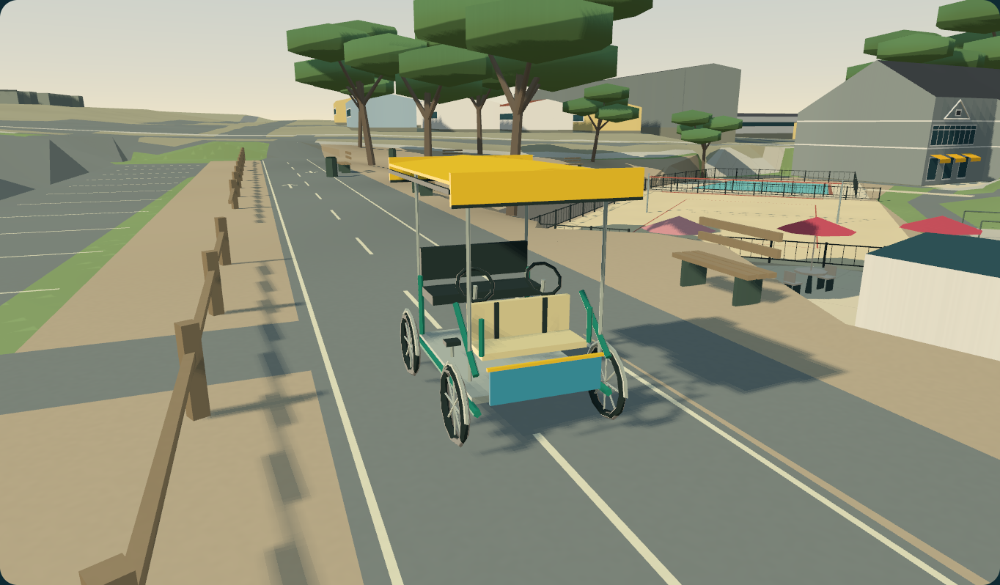
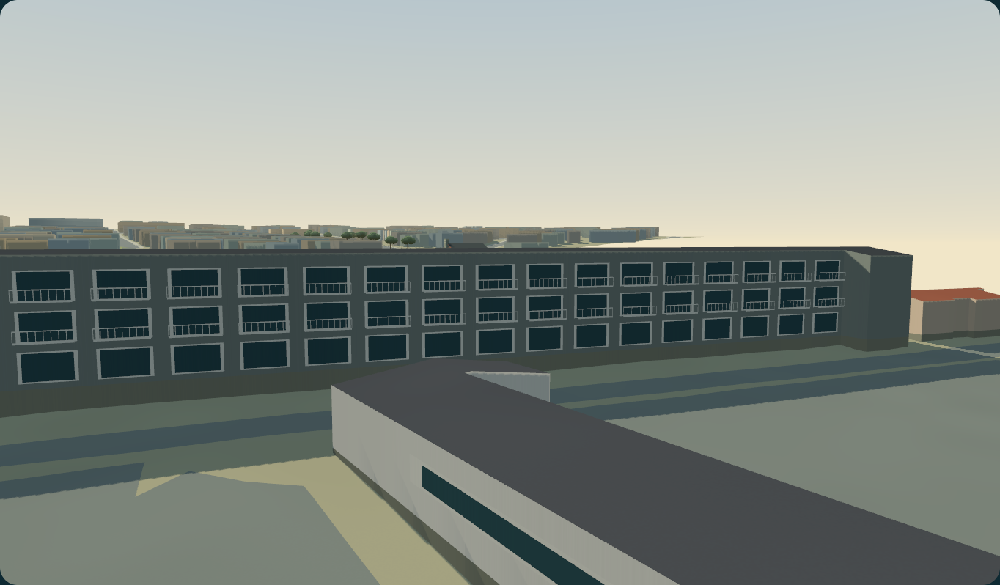
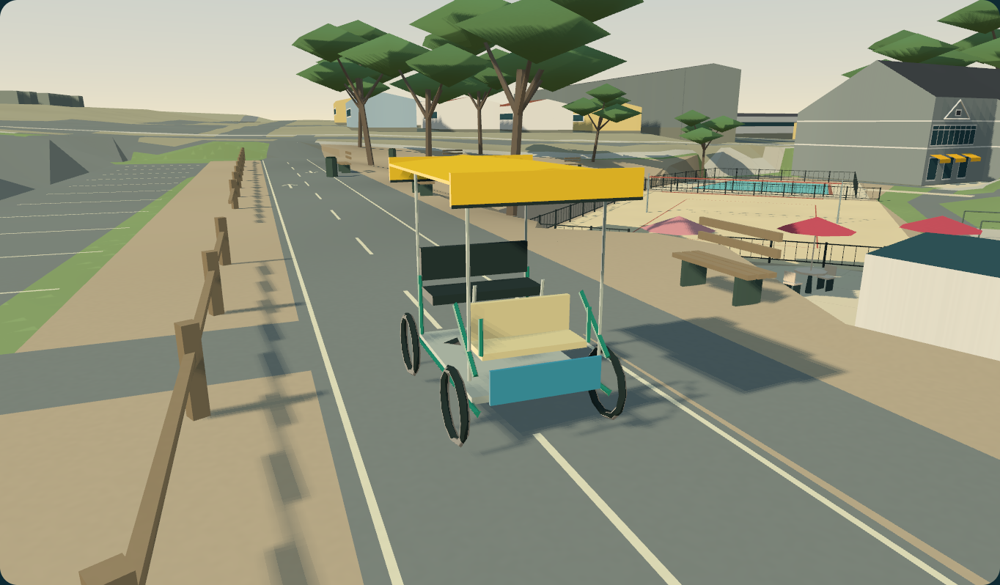

# Lovers Point and surrey review — November 6, 2026

See [the study](../lovers-point-surrey.md) for photo observations, provisional dimensions, controls and commands. Reference photographs remain outside the public repository. The images here are rendered from this project's procedural geometry.

## Form review

The initial pier followed the coarse terrain as many shallow slabs. The revised outer section reads as one level upper wall/deck, a lower landing and a diagonal stair flight. The hut's cream walls/red cap and the lodge's gray three-storey facade/white balcony rhythm are stronger identifying cues. The shoreline outline, inland approach grade, rock placement and exact building proportions remain approximations; this is not a survey-accurate replica.

The surrey keeps the reference's four narrow bicycle tires, green open frame, low front child seat, black adult bench, paired steering wheels and yellow canopy. Close-up review corrected the canopy closure, mudguards and a parking/tree overlap. Small woven strands, tire tread, text and flags are omitted deliberately.

## Measurements

The capture uses a 1400×900 browser viewport and a 1364×798 Gym canvas, 49° FOV, clear weather, November 6 at 13:00 Pacific, Balanced water, and fixed metre-space cameras. The supplied photographs use different cameras; these measurements establish repeatability and model scale, not pixel registration against the photos.

| View | Camera XYZ | Look-at XYZ |
| --- | --- | --- |
| Pier | 32, 10, 48 | 65, 3.5, 13 |
| Surrey | 7, 14, 99 | 3.1178, 12.5, 94.8854 |
| Lodge | -35, 23, -55 | -75, 19, -24 |
| Promenade | -32, 14.5, 73 | 5, 12, 97 |

The close surrey's projected bounding box is approximately 575×481 CSS pixels at the oblique camera. Authored frame variants preserve the slender canopy supports that automatic simplification removed; wheels and cranks retain automatic reductions. Forced Mid/Far comparisons retain its root, wheel pivots, seat and physics; automatic LOD still uses the shared projected-size thresholds. Enlarged Far captures are inspection views, not its intended display distance.

| Surrey detail | Triangles | Color-pass draws |
| --- | ---: | ---: |
| Near | 1,668 | 6 |
| Mid | 1,532 | 6 |
| Far | 720 | 6 |

Geometry families occupy about 330 KiB in the Node model report; browser backend attributes can increase the recorded storage after rendering. The 3,000-triangle/6-draw asset ceiling is enforced. Full-scene renderer counts include scenery, wildlife and shadow passes and must not be substituted for these model costs.

The shared Map Study park recorded 48,575 / 42,980 / 36,790 Near/Mid/Far triangles and 20 draws per level before culling on both backends. This is the detailed park root, not the full regional map. Geometry storage was approximately 5.04 MiB on WebGPU and 4.97 MiB on WebGL 2.

The [capture measurements](lovers-point-measurements.json) include both backend render counters and fixed camera settings.

## Validation

The complete unit run passed 588 tests. After the final authored frame LOD refinement, all 69 affected model/LOD/inventory tests passed on rerun. Production build, documentation and tracked-source release checks also passed.

- Model/vehicle tests: metre dimensions, useful LOD reductions, root ownership, thin-obstacle rejection, cliffs, braking, reverse steering, real coastal trail clearance and safe exits.
- Both graphics backends: normal UI boarding, keyboard travel, phase advancement, release braking, reverse steering, nearby dismount, reboarding and leaving the Gym; no captured page exceptions.
- Shared Map Study: rendered on WebGPU and WebGL 2 with identical triangle/draw counts and the new photo-assessment metadata.
- Existing terrain/access checks preserve mapped centerline traversal, supported building foundations and single-surface ground coverage across LOD.

Desktop Chrome checks do not establish physical phone, gamepad, Safari or Firefox support. Kinematic collisions are conservative, and the rider pose is stylized rather than a full pedal-contact IK solver.

## Clear bike-path correction

User review confirmed that the paved bike lane has no trees. Three overlapping cypress placements (inventory IDs 4869, 4870, 4871) now sit in the adjacent planting strip. Original GIS coordinates are preserved separately; these render-placement overrides also drive Gym collision and canopy shading and the Map Study. Tree count, geometry and draw costs are unchanged. Updated screenshots were inspected on WebGPU and WebGL; 18 focused tree, terrain and vehicle tests plus the production build passed. A regression checks every trunk against both mapped trail segments and the crossing, including collision clearance.
